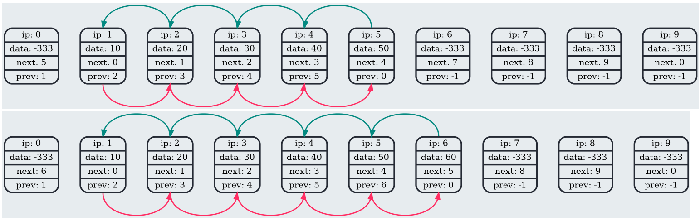

# Doubly Linked List

A small C project that implements a fixed-capacity doubly linked list using array-based storage.

The project includes:

- a list library with insertion, deletion, search, and access operations
- a demo executable that creates a list, pushes several elements, and generates a dump
- a visualization-oriented dump system that exports the internal list state into Graphviz format and generates an HTML page referencing dump images

## Overview

This implementation stores the list inside a structure with static arrays for:

- element values
- `next` links
- `prev` links

The list has a fixed maximum size defined at compile time:

- `kSize = 10`

## Features

- fixed-capacity doubly linked list
- push to front
- push to back
- insert before a given node
- insert after a given node
- delete a node by index
- access front and back nodes
- move to next and previous nodes
- get node value by index
- search by value
- internal consistency checks with assertions
- Graphviz dump generation for debugging and visualization
- HTML dump page generation

## Project Structure

A project structure is:

```text
.
├── CMakeLists.txt
├── .gitignore
├── README.md
├── include/
│   └── list.h
└── src/
    ├── list.c
    └── main.c
```

## Build

The project uses CMake.

### Requirements

- C compiler
- CMake 3.11 or newer
- Graphviz if you want to render `.gv` dump files into `.png`

### Get code

```bash
git clone https://github.com/lavrt/DoublyLinkedList
cd DoublyLinkedList
```

### Build steps

```bash
cmake -S . -B build/ -DCMAKE_BUILD_TYPE=Release
cmake --build build/ -j
```

### Run

After building, run the demo executable:

```bash
./build/list
```

The demo:

1) creates a list
2) inserts values `10, 20, 30, 40, 50` to the front
3) generates a dump
4) destroys the list

## Public API

The library exposes the following operations:

### Construction and destruction

- ctor — initialize the list
- dtor — reset and destroy the list

### Insertion

- pushFront — insert element at the beginning

- pushBack — insert element at the end

- pushBeforeNth — insert before a given index

- pushAfterNth — insert after a given index

### Removal

- deleteNth — remove element at a given index

### Access

- front — get the first node index

- back — get the last node index

- next — get the next node index

- prev — get the previous node index

- getNth — get the value stored at a given index

### Search

- search — find a node by value

### Debugging

- dump — generate a Graphviz dump of the current list state

## Error Handling

The project defines an `ErrorCodes` enum with the following possible states:

- `Success`
- `ElementNotFound`
- `ListOverflow`
- `ListUnderflow`
- `OutOfBoundsListAccess`
- `DumpFileOpenningError`
- `NullPointerDereference`

The implementation uses internal checks through `LISTASSERT(...)`.
If an invariant is violated, the program prints diagnostic information, creates a dump, destroys the list, and stops with `assert(0)`.

## Dump and Visualization

One of the main educational features of the project is the dump system.

When `dump(...)` is called, the program:

1) creates a timestamped `.gv` Graphviz file
2) appends its name to `namesOfGraphs.txt`
3) generates `dump.html`
4) prints Graphviz commands that can be used to render `.gv` files into `.png`

Example command pattern:

```bash
dot <dump_file>.gv -Tpng -o <dump_file>.png
```

After rendering the images, you can open `dump.html` in a browser to inspect the generated visualizations:



## Example

Example usage from `main.c`:

```c
dblLinkedList list = {};
ctor(&list);

for (size_t i = 10; i <= 50; i += 10) {
    pushFront(&list, i);
}

dump(&list);
dtor(&list);
```

## Notes

- The list has a fixed size and does not grow dynamically
- The implementation is intended primarily for learning rather than production use
